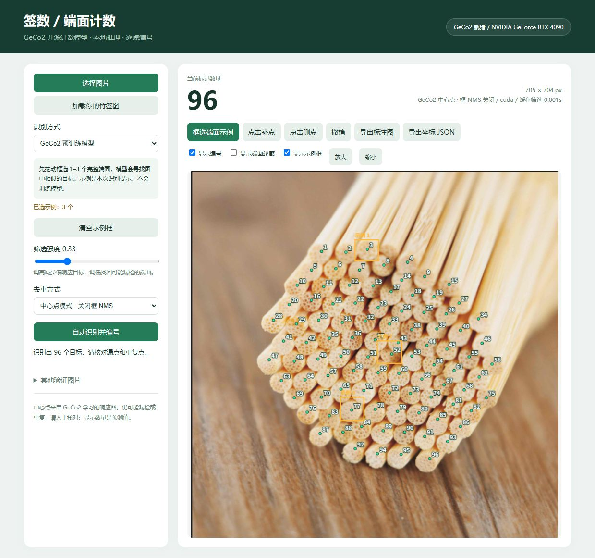

# 签数：GeCo2 本地端面计数

已经接入官方 GeCo2 预训练计数模型，在本机 RTX 4090 上运行。上传图片，框选少量完整端面作为提示，模型输出目标中心，再逐点编号计数。默认关闭框 NMS，可切换 NMS 对照；保留 OpenCV 基线。

## 安装与启动

推荐 Python 3.12。Windows + NVIDIA 显卡：

```powershell
git clone https://github.com/Mikky574/bamboo-stick-counter.git
cd bamboo-stick-counter
python -m venv .venv
.venv/Scripts/python.exe -m pip install torch==2.6.0 torchvision==0.21.0 --index-url https://download.pytorch.org/whl/cu126
.venv/Scripts/python.exe -m pip install -r requirements-model.txt
.venv/Scripts/python.exe download_weights.py
.venv/Scripts/python.exe app.py
```

访问 http://127.0.0.1:5080 。服务仅监听本机，推理不上传图片。环境准备好后也可运行 `./start.ps1`。当前原开发电脑已准备好环境和权重。

无 NVIDIA 显卡时可安装对应平台的 PyTorch CPU 版本，速度会更慢。

## Release 文件

下载入口：https://github.com/Mikky574/bamboo-stick-counter/releases/tag/v0.1.0

- `CNTQG_multitrain_ca44.pth`：GeCo2 官方预训练权重，放到 models/；下载脚本可自动获取并校验。
- `fsc147-annotations.zip`：FSC-147 点标注、类别和划分文件及原许可证，解压至项目根目录；不含完整图片集。
- `validation-results.zip`：本次竹签模型输出 PNG、坐标 JSON、页面截图和检查报告。
- `SHA256SUMS.txt` / `manifest.json`：各资产的大小、来源与校验值。

未重新分发厂商棉签目录和无明确许可的木材参考照片；本机原有文件保留，公开仓库保留来源链接。公开克隆可直接运行竹签模型验证和合成图验证，缺少棉签图片时对应验证明确跳过。



## 使用模型

1. 点击“加载你的竹签图”，会自动提供三个端面示例；新上传图片则需要自行拖动框选 1–3 个完整端面。
2. 选择 GeCo2 预训练模型，点击“自动识别并编号”。第一次需要加载权重，之后可以缓存筛选结果。
3. “筛选强度”提高会过滤低响应目标，降低会找回可能漏掉的端面。数值是相对中心响应，不能当作置信概率。
4. 默认中心点模式关闭框 NMS；可选择框 NMS 对照模式并设置 IoU。页面报告删除了多少候选。
5. 可以点击补点、删点、撤销；支持显示编号、轮廓、示例框和放大查看。导出 PNG 与 JSON，JSON 包含原图坐标、示例框、模型设置、自动数量和人工修改信息。

示例框是当前图片的推理提示，不会训练模型，也不需要每根手动画框。

## 实际验证结果

用户提供的 705×704 竹签图，选 3 个端面，阈值 0.33：

- 中心点模式：96 个预测点。
- 框 NMS IoU=0.5：仍为 96，删除 0 个候选。
- 阈值 0.20 / 0.50：分别输出 97 / 95 个点。

96 是预测值，尚未建立独立人工真值，不宣称 100% 准确。未在本项目用该图训练模型，但无法排除开源模型预训练时见过其公共来源图片。

模型、数据集和部署改动的详细核查见 docs/open_source_research.md；源码/权重版本和 SHA-256 见 models/provenance.json。

## 模型机制与适配

GeCo2 是有公开权重的少样本计数框架，官方模型预测中心响应图和框。这里使用其学习到的中心峰值，默认关闭框 NMS 和 SAM2 掩膜细化；这不是 P2PNet 式纯点回归，也不是完整官方分割评测配置。局部极大值选峰仍可能漏掉非常接近的目标。

Windows 下调用作者仓库中现有的 PyTorch deformable-attention 实现，不要求编译自定义 CUDA 扩展。推理使用的所有参数严格加载，只有训练辅助头被排除；没有用随机权重替代检测模型。源码及许可证保留在 vendor/geco2。

## 命令行和验证

```powershell
.venv/Scripts/python.exe model_cli.py samples/user_bamboo.png --demo-exemplars --output outputs/model_result
.venv/Scripts/python.exe model_cli.py samples/user_bamboo.png --demo-exemplars --nms-iou 0.5 --output outputs/nms_result
.venv/Scripts/python.exe verify_model.py
```

对其他照片，使用 `--exemplars boxes.json`，文件内容为 `[[x1,y1,x2,y2], ...]`，坐标单位为原图像素。`--demo-exemplars` 仅用于内置用户竹签图。

verify_model.py 检查真实 GPU 推理、坐标范围、缓存、NMS 对照、无效示例拒绝与 PNG 导出。它是功能验证，不是带人工真值的准确率评测。

## OpenCV 基线

页面切换 OpenCV，可用阈值、直径、筛选强度计数。适合对比明显、清晰分开的端面。运行 `python verify.py` 可复现：合成图 80/80、真实棉签裁剪图 3/3、完整粘连棉签图 4/7。合成图不是真实照片；成功裁剪图不代表完整照片正确。

原棉签照片来自安庆嘉欣医疗公开产品目录第 33 页：
https://pub-mediabox-storage.rxweb-prd.com/exhibitor/document/exh-14651c2f-63d7-40e0-9636-59660eaadac5/48e3843f-0482-41cb-9444-65c4f2655ee6.pdf

原目录与提取图片在 samples 中，仅作本地验证，权利归原作者。real_cotton_crop.jpg 裁剪范围：x=135:260，y=35:145。木材参考图来自 https://github.com/LelandYan/Image_processing ，未作为竹签验证证据；没有复制该仓库代码。

## 开源来源

- GeCo2：https://github.com/jerpelhan/GECO2
- FSC-147：https://github.com/cvlab-stonybrook/LearningToCountEverything
- 竹子计数社区数据页面：https://universe.roboflow.com/object-counting-redi5/bamboo-counting-test/dataset/8 （未下载训练，场景匹配尚未逐图核查）
